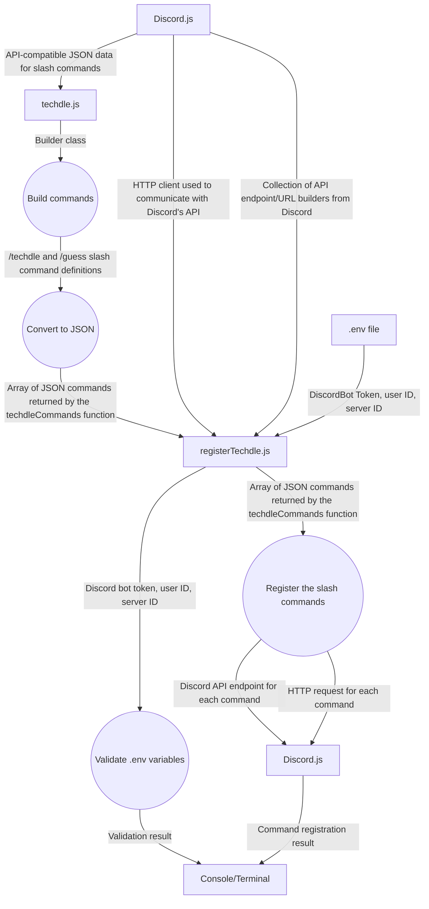
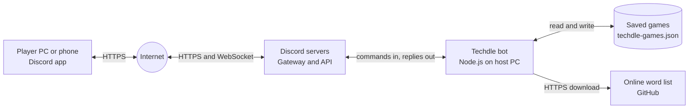
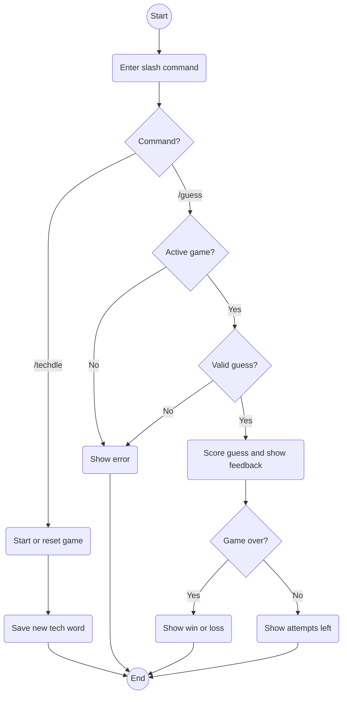

# Techdle Diagram

This diagram shows how our Techdle bot uses `/techdle` and `/guess` commands to saved game files.

# Aythan - Data Flow
This diagram shows the dataflows between Discord's API and our bot.


# Anthony - Network Diagram
This diagram shows the devices and networks involved when someone plays Techdle. Players never talk to the bot directly: everything goes through the Internet and Discord's servers.



| Connection | Protocol | What it carries |
|---|---|---|
| Player ↔ Internet | HTTPS | Messages and slash commands from the Discord app |
| Internet ↔ Discord servers | HTTPS and WebSocket | Player commands going in, bot replies coming out |
| Discord servers ↔ Techdle bot | WebSocket in, HTTPS out | `/techdle` and `/guess` commands in, the bot's replies out |
| Techdle bot ↔ Saved games | File read and write | Each player's current game in `data/techdle-games.json` |
| Techdle bot → Online word list | HTTPS download | The word list hosted on GitHub |

The bot never needs its own public address. When it starts, it opens an outgoing WebSocket connection to Discord, and Discord pushes player commands down that connection. Replies go back to Discord over HTTPS. The bot logs in with the token stored in `.env`, which stays on the host PC and is never committed to GitHub.

# Mario - Control Flow
This diagram shows the control flow between user inputs and outputs, changing logic depending on entries are valid or invalid. 


# Sida - Class Diagram

# Abhi - Use Case and Activity Diagram

The use case diagram below shows how a player interacts with TechdleBot through its two slash commands. Players can start or reset a game with `/techdle` and submit guesses with `/guess`. A game must be started before a player can submit a guess.

```mermaid
usecase-beta
direction TB

actor Player

systemBoundary "TechdleBot"
  StartGame("Start or reset game with /techdle")
  SubmitGuess("Submit a five-letter guess with /guess")
end

Player --> StartGame
Player --> SubmitGuess
```

The activity diagram shows how TechdleBot handles its two slash commands. The `/techdle` command starts a new game or resets an existing one with a new word. The `/guess` command checks whether the player has an active game and submitted a valid five-letter guess. The bot then provides feedback and either displays the remaining attempts or ends the game with a win or loss.




Each player has one current game. Starting `/techdle` again replaces that player's game. Guesses must be five letters and any five-letter guess is scored without checking a word list. Invalid guesses use no attempts.

**Code:** `src/events/interactionCreate.js` handles commands and replies; `src/game/` contains the rules and feedback; `src/game/store.js` saves games; and `src/game/words.js` provides tech answers.
